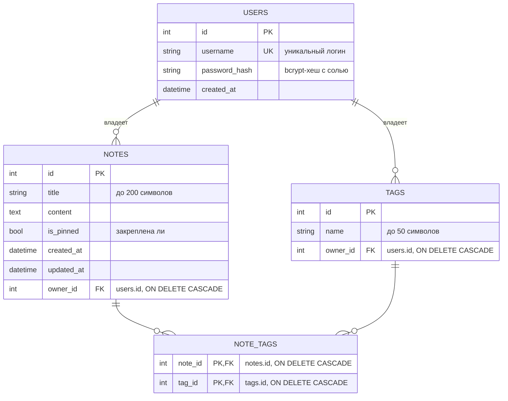

# Заметки с тегами

Веб-приложение для заметок: регистрируешься, входишь и работаешь только со своими
заметками и тегами. Можно искать по тексту, фильтровать по тегу и по закреплённым,
сортировать, листать страницы и смотреть статистику по тегам.

Учебная практика, 3 курс, вариант 7.

**Автор:** Григорьев Даниил
**Группа:** ИСиП 1-9-24

---

## Что умеет

- регистрация и вход (пароли хранятся в виде bcrypt-хеша);
- создание, редактирование и удаление заметок;
- теги: свои у каждого пользователя, у заметки их может быть несколько;
- поиск по заголовку и тексту;
- фильтры: по тегу и «только закреплённые»;
- сортировка и пагинация (кнопка «Показать ещё»);
- статистика: сколько заметок у каждого тега;
- экспорт заметок в CSV.

---

## Стек

| Слой | Технологии |
|------|------------|
| Бэкенд | Python, FastAPI, Pydantic v2 |
| БД | SQLite, SQLAlchemy 2.0 |
| Миграции | Alembic |
| Авторизация | `SessionMiddleware`, подписанная cookie, bcrypt (без JWT) |
| Фронтенд | HTML, CSS, JavaScript (ES-модули), `fetch`, без фреймворков |

Фронтенд раздаёт сам FastAPI через `StaticFiles`, поэтому всё живёт на одном адресе
и CORS не нужен.

---

## Запуск

Все команды выполняются из корня проекта (там, где лежит `alembic.ini`).

### Windows

```bat
python -m venv venv
venv\Scripts\activate
pip install -r requirements.txt
alembic upgrade head
uvicorn app.main:app --reload
```

### Linux / macOS

```bash
python3 -m venv venv
source venv/bin/activate
pip install -r requirements.txt
alembic upgrade head
uvicorn app.main:app --reload
```

После запуска:

- приложение — <http://127.0.0.1:8000/> (перекинет на страницу входа);
- вход — <http://127.0.0.1:8000/static/login.html>;
- регистрация — <http://127.0.0.1:8000/static/register.html>;
- документация API (Swagger) — <http://127.0.0.1:8000/docs>.

> Первый запуск без `alembic upgrade head` не сработает: таблицы создаются только
> миграцией. Файл базы `app.db` в репозиторий не попадает.

### Переменные окружения (необязательно)

| Переменная | Назначение | По умолчанию |
|------------|------------|--------------|
| `SECRET_KEY` | ключ подписи cookie сессии | длинный ключ из `app/main.py` |
| `DATABASE_URL` | строка подключения SQLAlchemy | `sqlite:///./app.db` |

---

## Структура проекта

```text
project/
├── app/
│   ├── main.py            # сборка приложения, SessionMiddleware, StaticFiles
│   ├── database.py        # engine, SessionLocal, Base, get_db, PRAGMA foreign_keys
│   ├── models.py          # User, Note, Tag, note_tags
│   ├── schemas.py         # схемы Pydantic (Create / Update / Out)
│   ├── security.py        # хеширование и проверка паролей
│   ├── deps.py            # get_current_user
│   └── routers/
│       ├── auth.py        # регистрация, вход, выход, /me
│       ├── notes.py       # CRUD заметок, поиск, фильтры, статистика, CSV
│       └── tags.py        # создание, список и удаление тегов
├── app/static/            # index / login / register + css и js
├── migrations/            # Alembic
├── alembic.ini
├── requirements.txt
├── README.md
└── ОТЧЕТ.md               # отчёт по практике
```

---

## Схема БД



Коротко о связях:

- у пользователя много заметок и много тегов;
- заметка может иметь несколько тегов, тег — несколько заметок (таблица `note_tags`);
- `UNIQUE(owner_id, name)` в `tags`: у одного пользователя теги не повторяются;
- у заметки 7 полей разных типов: `int`, `str`, `text`, `bool`, два `datetime`
  и внешний ключ.

---

## API

Все эндпоинты, кроме регистрации и входа, требуют активной сессии, иначе **401**.

### Авторизация

| Метод | URL | Что делает | Коды |
|-------|-----|------------|------|
| POST | `/api/auth/register` | регистрация (логин 3–50, пароль ≥ 6) | 201, 400, 422 |
| POST | `/api/auth/login` | вход, пишет `user_id` в сессию | 200, 401, 422 |
| POST | `/api/auth/logout` | выход, очищает сессию | 204 |
| GET | `/api/auth/me` | текущий пользователь | 200, 401 |

### Заметки

| Метод | URL | Что делает | Коды |
|-------|-----|------------|------|
| GET | `/api/notes` | список с поиском, фильтрами, сортировкой и пагинацией | 200, 401, 422 |
| GET | `/api/notes/{note_id}` | одна заметка (только своя) | 200, 401, 404 |
| POST | `/api/notes` | создание | 201, 401, 422 |
| PATCH | `/api/notes/{note_id}` | частичное изменение | 200, 401, 404, 422 |
| DELETE | `/api/notes/{note_id}` | удаление | 204, 401, 404 |
| GET | `/api/notes/stats` | число заметок по тегам | 200, 401 |
| GET | `/api/notes/export` | экспорт в CSV | 200, 401 |

Параметры `GET /api/notes`:

| Параметр | Значение | По умолчанию |
|----------|----------|--------------|
| `search` | подстрока по заголовку и тексту | — |
| `tag_id` | фильтр по id тега | — |
| `pinned_only` | `true` — только закреплённые | `false` |
| `sort` | `created_desc`, `created_asc`, `title_asc`, `title_desc` | `created_desc` |
| `limit` | 1…100 | 10 |
| `offset` | ≥ 0 | 0 |

### Теги

| Метод | URL | Что делает | Коды |
|-------|-----|------------|------|
| GET | `/api/tags` | список тегов пользователя | 200, 401 |
| POST | `/api/tags` | создание тега | 201, 400, 401, 422 |
| DELETE | `/api/tags/{tag_id}` | удаление тега | 204, 401, 404 |

---

## Как работает вариант 7

- **Поиск** — `ilike` сразу по `title` и `content`.
- **Фильтр по тегу** — выпадающий список тегов текущего пользователя.
- **Закреплённые заметки** — поле `is_pinned`, закреплённые всегда идут первыми
  (`ORDER BY is_pinned DESC, ...`), плюс отдельный фильтр `pinned_only`.
- **Статистика** — `func.count` + `GROUP BY` по тегам.
- **Пагинация** — `limit` / `offset` и кнопка «Показать ещё».

---

## Безопасность

- пароли — только bcrypt-хеш с солью;
- все эндпоинты данных закрыты `Depends(get_current_user)`;
- в каждом запросе есть условие `owner_id == user.id`, `owner_id` берётся из сессии,
  а не из тела запроса;
- `password_hash` никогда не попадает в ответы API (схема `UserOut`);
- текст пользователя выводится через `textContent`, а не `innerHTML` — защита от XSS;
- чужая заметка отдаёт **404**, а не 403: не подсказываем, что она существует;
- в SQLite включён `PRAGMA foreign_keys=ON`, поэтому работают `ON DELETE CASCADE`;
- `app.db`, `venv`, `__pycache__` исключены через `.gitignore`.

---

## Проверка изоляции данных

1. Зарегистрировать `alice`, создать пару заметок и тегов.
2. Выйти и зарегистрировать `bob`.
3. Убедиться, что `bob` не видит заметки и теги `alice`.
4. Запросить чужую заметку `GET /api/notes/<id_alice>` → **404**.
5. Попробовать изменить или удалить её → тоже **404**.
