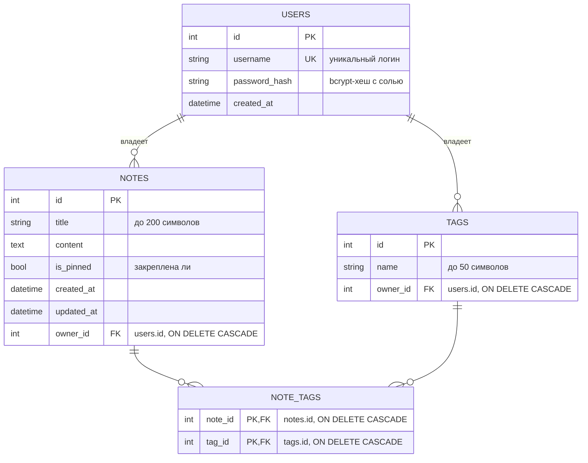

# Заметки с тегами

Учебная практика, 3 курс. **Вариант 7 — «Заметки с тегами»**.

Клиент-серверное веб-приложение: пользователь регистрируется, входит и работает
только со своими заметками и тегами. Реализованы поиск по тексту, фильтр по тегу,
фильтр по закреплённым заметкам, сортировка, пагинация и статистика по тегам.

**Автор:** _ФИО_
**Группа:** _номер группы_
**Вариант:** 7

---

## 1. Стек

| Слой | Технологии |
|------|------------|
| Бэкенд | Python, FastAPI, APIRouter, Pydantic v2 |
| БД | SQLite, SQLAlchemy 2.0 (`Mapped` / `mapped_column`, `select`) |
| Миграции | Alembic (все таблицы создаются только миграцией) |
| Авторизация | `SessionMiddleware`, подписанная cookie, bcrypt-хеш пароля с солью (JWT не используется) |
| Фронтенд | HTML, CSS, JavaScript (ES-модули), `fetch`, без фреймворков |
| Раздача фронтенда | `StaticFiles` внутри FastAPI |

---

## 2. Установка и запуск

Все команды выполняются **из корня проекта** (там, где лежит `alembic.ini`).

### Windows (PowerShell / cmd)

```bat
python -m venv venv
venv\Scripts\activate
pip install -r requirements.txt
alembic upgrade head
uvicorn app.main:app --reload
```

### Linux / macOS

```bash
python3 -m venv venv
source venv/bin/activate
pip install -r requirements.txt
alembic upgrade head
uvicorn app.main:app --reload
```

После запуска:

* приложение — <http://127.0.0.1:8000/> (редирект на страницу входа);
* вход — <http://127.0.0.1:8000/static/login.html>;
* регистрация — <http://127.0.0.1:8000/static/register.html>;
* Swagger — <http://127.0.0.1:8000/docs>.

> Если БД ещё не создана — обязательно выполните `alembic upgrade head`.
> Файл `app.db` в репозиторий не коммитится.

### Переменные окружения (необязательно)

| Переменная | Назначение | По умолчанию |
|------------|------------|--------------|
| `SECRET_KEY` | ключ подписи cookie сессии | длинный ключ из `app/main.py` |
| `DATABASE_URL` | строка подключения SQLAlchemy | `sqlite:///./app.db` |

---

## 3. Структура проекта

```text
project/
├── app/
│   ├── main.py            # сборка приложения, SessionMiddleware, StaticFiles
│   ├── database.py        # engine, SessionLocal, Base, get_db, PRAGMA foreign_keys
│   ├── models.py          # User, Note, Tag, note_tags
│   ├── schemas.py         # схемы Pydantic (Create / Update / Out)
│   ├── security.py        # хеширование и проверка паролей (bcrypt)
│   ├── deps.py            # get_current_user
│   └── routers/
│       ├── auth.py        # регистрация, вход, выход, /me
│       ├── notes.py       # CRUD заметок, поиск, фильтры, сортировка, пагинация, статистика, CSV
│       └── tags.py        # создание, список и удаление тегов
├── app/static/
│   ├── index.html         # главная: список, поиск, фильтры, форма добавления
│   ├── login.html         # вход
│   ├── register.html      # регистрация
│   ├── css/style.css      # единый стиль, адаптив
│   └── js/
│       ├── api.js         # обёртка над fetch + обработка ошибок
│       ├── auth.js        # логика входа
│       ├── register.js    # логика регистрации
│       └── index.js       # список, фильтры, создание/редактирование/удаление
├── migrations/            # Alembic
├── alembic.ini
├── requirements.txt
├── README.md
└── ОТЧЕТ.md               # отчёт по практике
```

---

## 4. Схема БД



Связи:

* `User 1 — N Note` — у пользователя много заметок;
* `User 1 — N Tag` — у пользователя много тегов;
* `Note N — N Tag` — заметка может иметь много тегов, тег — много заметок
  (реализовано через таблицу `note_tags`);
* `UNIQUE(owner_id, name)` в `tags` — у одного пользователя теги не повторяются;
* у основной сущности `notes` 7 полей разных типов: `int`, `str`, `text`, `bool`,
  `datetime` (×2), внешний ключ.

---

## 5. Эндпоинты

Все эндпоинты, кроме регистрации и входа, требуют активной сессии
(`Depends(get_current_user)`), иначе возвращают **401**.

### Авторизация

| Метод | URL | Назначение | Коды ответа |
|-------|-----|------------|-------------|
| POST | `/api/auth/register` | регистрация (логин 3–50, пароль ≥ 6) | 201, 400, 422 |
| POST | `/api/auth/login` | вход, записывает `user_id` в сессию | 200, 401, 422 |
| POST | `/api/auth/logout` | выход, очищает сессию | 204 |
| GET | `/api/auth/me` | текущий пользователь | 200, 401 |

### Заметки (основная сущность)

| Метод | URL | Назначение | Коды ответа |
|-------|-----|------------|-------------|
| GET | `/api/notes` | список с поиском, фильтрами, сортировкой и пагинацией | 200, 401, 422 |
| GET | `/api/notes/{note_id}` | одна заметка (только своя) | 200, 401, 404 |
| POST | `/api/notes` | создание | 201, 401, 422 |
| PATCH | `/api/notes/{note_id}` | изменение (частичное) | 200, 401, 404, 422 |
| DELETE | `/api/notes/{note_id}` | удаление | 204, 401, 404 |
| GET | `/api/notes/stats` | статистика: количество заметок по тегам (`GROUP BY`) | 200, 401 |
| GET | `/api/notes/export` | экспорт списка в CSV (доп. возможность) | 200, 401 |

Параметры `GET /api/notes`:

| Параметр | Значение | По умолчанию |
|----------|----------|--------------|
| `search` | подстрока для `ilike` по `title` и `content` | — |
| `tag_id` | фильтр по id тега | — |
| `pinned_only` | `true` — только закреплённые | `false` |
| `sort` | `created_desc`, `created_asc`, `title_asc`, `title_desc` | `created_desc` |
| `limit` | 1…100 | 10 |
| `offset` | ≥ 0 | 0 |

### Теги (вторая сущность)

| Метод | URL | Назначение | Коды ответа |
|-------|-----|------------|-------------|
| GET | `/api/tags` | список тегов пользователя | 200, 401 |
| POST | `/api/tags` | создание тега | 201, 400, 401, 422 |
| DELETE | `/api/tags/{tag_id}` | удаление тега | 204, 401, 404 |

---

## 6. Особенность варианта 7

* **Поиск по тексту** — `ilike` одновременно по заголовку и содержимому.
* **Фильтр по тегу** — выпадающий список тегов пользователя.
* **Закреплённые заметки**:
  * поле `is_pinned` в модели;
  * закреплённые всегда идут первыми (`ORDER BY is_pinned DESC, ...`);
  * отдельный фильтр «Только закреплённые» (`pinned_only=true`);
  * кнопка «Закрепить / Открепить» в карточке.
* **Статистика** — количество заметок по каждому тегу через `func.count` + `GROUP BY`.
* **Пагинация** — `limit` / `offset` + кнопка «Показать ещё».

Дополнительно реализовано: **экспорт заметок в CSV** (кнопка «Экспорт CSV»).

---

## 7. Безопасность (чек-лист)

* [x] Пароли хранятся только как bcrypt-хеш с солью (`app/security.py`).
* [x] `secret_key` — длинная случайная строка, не `secret` и не `123`.
* [x] Все эндпоинты данных закрыты `Depends(get_current_user)`.
* [x] В каждом запросе к данным есть условие `owner_id == user.id`.
* [x] `owner_id` берётся из сессии, а не из тела запроса/формы.
* [x] В ответах API нет `password_hash` (схема `UserOut`).
* [x] Удаление/изменение выполняется только после выборки записи с проверкой владельца.
* [x] Текст пользователя выводится через `textContent` (защита от XSS).
* [x] Без входа главная страница перенаправляет на страницу входа.
* [x] Ошибки (400, 401, 404, 422) показываются пользователю в интерфейсе.
* [x] `app.db`, `venv`, `__pycache__` исключены через `.gitignore`.
* [x] SQLite: включён `PRAGMA foreign_keys=ON`, работают `ON DELETE CASCADE`.

---

## 8. Скриншоты

Положите скриншоты в `docs/screenshots/`:

1. `login.png` — страница входа;
2. `register.png` — страница регистрации;
3. `index.png` — главная со списком, поиском и фильтрами;
4. `edit.png` — редактирование заметки;
5. `swagger.png` — Swagger `/docs`.

---

## 9. Проверка сценария «два пользователя»

1. Зарегистрировать пользователя `alice`, создать 2–3 заметки и теги.
2. Выйти, зарегистрировать `bob`.
3. Убедиться, что `bob` не видит заметки и теги `alice`.
4. Запросить чужую заметку: `GET /api/notes/<id_alice>` → **404**.
5. Попробовать изменить/удалить чужую заметку → **404**.

---

## 10. Ответы на вопросы защиты (кратко)

1. **`.scalars().all()` vs `.all()` vs `.scalar_one_or_none()`** —
   `.all()` возвращает список кортежей (`Row`); `.scalars().all()` — список
   скалярных объектов (например, `Note`); `.scalar_one_or_none()` — ровно один
   скаляр или `None`, а при нескольких строках бросает исключение.
2. **Без `commit()` после `insert`** — изменения останутся только в транзакции
   сессии и откатятся при закрытии; в БД ничего не сохранится.
3. **Пагинация** — `limit`/`offset`; для 3-й страницы при `limit=10`:
   `... LIMIT 10 OFFSET 20`.
4. **`GROUP BY` в проекте** — `/api/notes/stats`: считает число заметок по тегам
   (`func.count` + `GROUP BY tags.name`).
5. **Зачем `...Out` и `response_model`** — валидация и сериализация ответа,
   отсечение лишних полей (например, `password_hash`), документация в OpenAPI.
6. **CORS** — не нужен: фронтенд и API на одном origin (раздаются одним FastAPI).
7. **`await` перед `fetch`/`json()`** — обе операции асинхронные и возвращают
   промисы; `await` дожидается результата.
8. **`textContent`, а не `innerHTML`** — `innerHTML` исполняет HTML/JS из данных
   пользователя (XSS), `textContent` выводит их как обычный текст.
9. **Где хранится факт входа** — в подписанной cookie сессии (`itsdangerous`);
   подделать нельзя без `SECRET_KEY`.
10. **Пароли** — bcrypt-хеш с индивидуальной солью; соль делает одинаковые
    пароли разными в БД и защищает от радужных таблиц.
11. **Чужая запись** — сервер вернёт **404**, проверка в `_get_own_note`
    (`select(...).where(Note.id == note_id, Note.owner_id == user.id)`).
12. **401 / 403 / 404 / 422** — не аутентифицирован / нет прав / не найдено /
    ошибка валидации данных.
