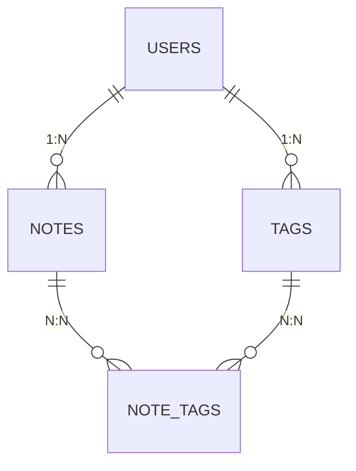

# ОТЧЁТ ПО УЧЕБНОЙ ПРАКТИКЕ

**Тема:** Клиент-серверное веб-приложение «Заметки с тегами»
**Вариант:** 7
**Студент:** _ФИО_
**Группа:** _номер группы_
**Курс:** 3
**Период практики:** _даты_

---

## Содержание

1. Цель и задачи практики
2. Описание предметной области
3. Схема базы данных
4. Перечень эндпоинтов
5. Скриншоты страниц и пояснения
6. Фрагменты ключевого кода
7. Выполнение требований безопасности
8. Тестирование
9. Вывод
10. Приложение. Ответы на вопросы к защите

---

## 1. Цель и задачи практики

**Цель:** закрепить работу с базой данных через SQLAlchemy, связать бэкенд и
фронтенд и реализовать вход пользователей в клиент-серверном веб-приложении.

**Задачи:**

1. Спроектировать БД для предметной области «Заметки с тегами» (вариант 7).
2. Описать модели SQLAlchemy 2.0 и создать таблицы миграцией Alembic.
3. Реализовать регистрацию, вход, выход и эндпоинт текущего пользователя.
4. Реализовать полный CRUD заметок и операции с тегами.
5. Добавить поиск, фильтр по тегу, фильтр закреплённых, сортировку, пагинацию
   и статистику.
6. Разработать фронтенд на HTML/CSS/JS без фреймворков.
7. Проверить разграничение доступа между пользователями.
8. Подготовить README и отчёт.

---

## 2. Описание предметной области

Приложение — личный блокнот с тегами. Пользователь регистрируется и получает
доступ только к своим данным.

Основные сущности:

* **Пользователь (User)** — логин, хеш пароля, дата регистрации.
* **Заметка (Note)** — заголовок, текст, признак закрепления, даты создания и
  изменения, владелец.
* **Тег (Tag)** — название и владелец. У одного пользователя названия тегов
  уникальны.
* **Связь заметок и тегов (note_tags)** — реализует отношение «многие ко многим».

Функциональные возможности:

* регистрация, вход, выход;
* создание, просмотр, изменение и удаление заметок;
* создание, просмотр и удаление тегов;
* привязка нескольких тегов к заметке;
* поиск по заголовку и тексту;
* фильтр по тегу и по закреплённым заметкам;
* сортировка по дате и заголовку;
* пагинация («Показать ещё»);
* статистика количества заметок по тегам;
* экспорт списка в CSV (дополнительная возможность).

---

## 3. Схема базы данных

### 3.1. Таблицы

**users**

| Поле | Тип | Ограничения | Назначение |
|------|-----|-------------|------------|
| id | INTEGER | PK, autoincrement | идентификатор |
| username | VARCHAR(50) | UNIQUE, NOT NULL | логин |
| password_hash | VARCHAR(255) | NOT NULL | bcrypt-хеш с солью |
| created_at | DATETIME | NOT NULL, default now | дата регистрации |

**notes**

| Поле | Тип | Ограничения | Назначение |
|------|-----|-------------|------------|
| id | INTEGER | PK, autoincrement | идентификатор |
| title | VARCHAR(200) | NOT NULL | заголовок |
| content | TEXT | NOT NULL | текст заметки |
| is_pinned | BOOLEAN | NOT NULL, default false | закреплена ли |
| created_at | DATETIME | NOT NULL, default now | дата создания |
| updated_at | DATETIME | NOT NULL, default now, onupdate now | дата изменения |
| owner_id | INTEGER | FK → users.id, NOT NULL, ON DELETE CASCADE, indexed | владелец |

**tags**

| Поле | Тип | Ограничения | Назначение |
|------|-----|-------------|------------|
| id | INTEGER | PK, autoincrement | идентификатор |
| name | VARCHAR(50) | NOT NULL | название тега |
| owner_id | INTEGER | FK → users.id, NOT NULL, ON DELETE CASCADE, indexed | владелец |

Дополнительно: `UNIQUE(owner_id, name)` — у одного пользователя тег уникален.

**note_tags**

| Поле | Тип | Ограничения | Назначение |
|------|-----|-------------|------------|
| note_id | INTEGER | PK, FK → notes.id, ON DELETE CASCADE | связь с заметкой |
| tag_id | INTEGER | PK, FK → tags.id, ON DELETE CASCADE | связь с тегом |

### 3.2. Связи



* `User 1 — N Note` — у пользователя много заметок.
* `User 1 — N Tag` — у пользователя много тегов.
* `Note N — N Tag` — заметка может иметь много тегов, тег — много заметок.
* Все данные принадлежат только своему пользователю; чужие записи недоступны (404).

Схема также приложена отдельным файлом [`бд.png`](бд.png).

---

## 4. Перечень эндпоинтов

### Авторизация

| Метод | URL | Назначение | Коды ответа |
|-------|-----|------------|-------------|
| POST | `/api/auth/register` | регистрация | 201, 400, 422 |
| POST | `/api/auth/login` | вход | 200, 401, 422 |
| POST | `/api/auth/logout` | выход | 204 |
| GET | `/api/auth/me` | текущий пользователь | 200, 401 |

### Заметки

| Метод | URL | Назначение | Коды ответа |
|-------|-----|------------|-------------|
| GET | `/api/notes` | список + поиск/фильтры/сортировка/пагинация | 200, 401, 422 |
| GET | `/api/notes/{note_id}` | одна заметка | 200, 401, 404 |
| POST | `/api/notes` | создание | 201, 401, 422 |
| PATCH | `/api/notes/{note_id}` | изменение | 200, 401, 404, 422 |
| DELETE | `/api/notes/{note_id}` | удаление | 204, 401, 404 |
| GET | `/api/notes/stats` | статистика по тегам (GROUP BY) | 200, 401 |
| GET | `/api/notes/export` | экспорт в CSV | 200, 401 |

Параметры `GET /api/notes`: `search`, `tag_id`, `pinned_only`, `sort`
(`created_desc`, `created_asc`, `title_asc`, `title_desc`), `limit`, `offset`.

### Теги

| Метод | URL | Назначение | Коды ответа |
|-------|-----|------------|-------------|
| GET | `/api/tags` | список тегов | 200, 401 |
| POST | `/api/tags` | создание | 201, 400, 401, 422 |
| DELETE | `/api/tags/{tag_id}` | удаление | 204, 401, 404 |

---

## 5. Скриншоты страниц и пояснения

Скриншоты следует положить в `docs/screenshots/` (файлы создаются после запуска
приложения). Рекомендуемый набор:

### 5.1. Страница входа — `login.png`

Поля «Логин» и «Пароль», кнопка «Войти», ссылка на регистрацию. При неверном
пароле под формой выводится сообщение «Неверный логин или пароль» (сервер
возвращает 401, но страница входа не перенаправляет сама на себя).

### 5.2. Страница регистрации — `register.png`

Проверка длины логина (3–50) и пароля (минимум 6) на клиенте и на сервере.
После успешной регистрации выполняется автоматический вход и переход на главную.

### 5.3. Главная страница — `index.png`

Отображает:

* имя пользователя и кнопку «Выйти»;
* блок поиска, фильтр по тегу, сортировку, чекбокс «Только закреплённые»;
* статистику по тегам;
* управление тегами (создание, удаление);
* форму создания заметки с выбором тегов;
* список заметок с кнопками «Изменить», «Закрепить/Открепить», «Удалить»;
* кнопку «Показать ещё» (пагинация) и «Экспорт CSV».

Состояния интерфейса: «Загрузка…», «Пока нет заметок…», сообщения об ошибках
(400, 401, 404, 422).

### 5.4. Редактирование заметки — `edit.png`

Кнопка «Изменить» разворачивает карточку в форму: заголовок, текст, флажок
закрепления и чекбоксы тегов. Сохранение отправляет `PATCH /api/notes/{id}`.

### 5.5. Swagger — `swagger.png`

Страница `/docs` со списком всех эндпоинтов и возможностью их проверки.

---

## 6. Фрагменты ключевого кода

### 6.1. Модели SQLAlchemy 2.0

```python
class User(Base):
    __tablename__ = "users"

    id: Mapped[int] = mapped_column(primary_key=True)
    username: Mapped[str] = mapped_column(String(50), unique=True, nullable=False)
    password_hash: Mapped[str] = mapped_column(String(255), nullable=False)
    created_at: Mapped[datetime] = mapped_column(
        DateTime, server_default=func.now(), nullable=False
    )

    notes: Mapped[list["Note"]] = relationship(
        back_populates="owner", cascade="all, delete-orphan"
    )
    tags: Mapped[list["Tag"]] = relationship(
        back_populates="owner", cascade="all, delete-orphan"
    )


class Note(Base):
    __tablename__ = "notes"

    id: Mapped[int] = mapped_column(primary_key=True)
    title: Mapped[str] = mapped_column(String(200), nullable=False)
    content: Mapped[str] = mapped_column(Text, nullable=False)
    is_pinned: Mapped[bool] = mapped_column(Boolean, default=False, nullable=False)
    created_at: Mapped[datetime] = mapped_column(
        DateTime, server_default=func.now(), nullable=False
    )
    updated_at: Mapped[datetime] = mapped_column(
        DateTime, server_default=func.now(), onupdate=func.now(), nullable=False
    )
    owner_id: Mapped[int] = mapped_column(
        ForeignKey("users.id", ondelete="CASCADE"), nullable=False, index=True
    )

    owner: Mapped["User"] = relationship(back_populates="notes")
    tags: Mapped[list["Tag"]] = relationship(
        secondary=note_tags, back_populates="notes", lazy="selectin"
    )
```

### 6.2. Запрос списка с поиском, фильтрами, сортировкой и пагинацией

```python
stmt = select(Note).where(Note.owner_id == user.id)

if search and search.strip():
    pattern = f"%{search.strip()}%"
    stmt = stmt.where(
        or_(Note.title.ilike(pattern), Note.content.ilike(pattern))
    )

if tag_id is not None:
    stmt = stmt.join(
        note_tags, note_tags.c.note_id == Note.id
    ).where(note_tags.c.tag_id == tag_id)

if pinned_only:
    stmt = stmt.where(Note.is_pinned.is_(True))

if sort == "created_asc":
    stmt = stmt.order_by(Note.is_pinned.desc(), Note.created_at.asc())
elif sort == "title_asc":
    stmt = stmt.order_by(Note.is_pinned.desc(), Note.title.asc())
elif sort == "title_desc":
    stmt = stmt.order_by(Note.is_pinned.desc(), Note.title.desc())
else:
    stmt = stmt.order_by(Note.is_pinned.desc(), Note.created_at.desc())

stmt = stmt.limit(limit).offset(offset)
return db.scalars(stmt).all()
```

### 6.3. Зависимость `get_current_user`

```python
def get_current_user(request: Request, db: Session = Depends(get_db)) -> User:
    user_id = request.session.get("user_id")
    if not user_id:
        raise HTTPException(
            status_code=status.HTTP_401_UNAUTHORIZED,
            detail="Not authenticated",
        )
    user = db.get(User, user_id)
    if not user:
        request.session.clear()
        raise HTTPException(
            status_code=status.HTTP_401_UNAUTHORIZED,
            detail="User not found",
        )
    return user
```

### 6.4. Проверка владельца записи (чужая заметка → 404)

```python
def _get_own_note(note_id: int, db: Session, user: User) -> Note:
    note = db.scalar(
        select(Note).where(Note.id == note_id, Note.owner_id == user.id)
    )
    if not note:
        raise HTTPException(status_code=404, detail="Note not found")
    return note
```

### 6.5. Статистика с `GROUP BY`

```python
rows = db.execute(
    select(Tag.name, func.count(note_tags.c.note_id))
    .join(note_tags, note_tags.c.tag_id == Tag.id)
    .join(Note, Note.id == note_tags.c.note_id)
    .where(Tag.owner_id == user.id, Note.owner_id == user.id)
    .group_by(Tag.name)
    .order_by(func.count(note_tags.c.note_id).desc(), Tag.name)
).all()
```

### 6.6. Отрисовка списка на фронтенде (безопасно, через `textContent`)

```javascript
function renderNote(note) {
  const card = document.createElement("div");
  card.className = "note" + (note.is_pinned ? " pinned" : "");

  const h3 = document.createElement("h3");
  h3.textContent = note.title;
  card.appendChild(h3);

  const content = document.createElement("div");
  content.className = "content";
  content.textContent = note.content;
  card.appendChild(content);

  // ... кнопки «Изменить», «Закрепить/Открепить», «Удалить»
  return card;
}
```

### 6.7. Хеширование пароля с солью

```python
def hash_password(password: str) -> str:
    pwd_bytes = password.encode("utf-8")[:72]
    salt = bcrypt.gensalt()
    return bcrypt.hashpw(pwd_bytes, salt).decode("utf-8")


def verify_password(plain: str, hashed: str) -> bool:
    pwd_bytes = plain.encode("utf-8")[:72]
    return bcrypt.checkpw(pwd_bytes, hashed.encode("utf-8"))
```

---

## 7. Выполнение требований безопасности

| Требование | Реализация |
|------------|------------|
| Пароли — только хеш с солью | `bcrypt.hashpw` + `gensalt`, поле `password_hash` |
| `secret_key` не «secret» | длинный случайный ключ, можно задать через `SECRET_KEY` |
| Все эндпоинты данных через `Depends(get_current_user)` | `notes.py`, `tags.py` |
| `owner_id == user.id` в каждом запросе | фильтр в select и проверка в `_get_own_note` |
| `owner_id` из сессии | `request.session["user_id"]`, не из тела запроса |
| Нет `password_hash` в ответах | схема `UserOut` |
| `textContent` вместо `innerHTML` | `index.js`, `renderNote` |
| Ошибки видны пользователю | блоки `.error`, обработка 400/401/404/422 в `api.js` |
| Нет `app.db` и `venv` в репозитории | `.gitignore` |
| Внешние ключи SQLite работают | `PRAGMA foreign_keys=ON` в `database.py` |

---

## 8. Тестирование

### 8.1. Проверка API в Swagger

1. `POST /api/auth/register` — создать пользователя (201).
2. `POST /api/auth/login` — войти (200), cookie сохраняется.
3. `GET /api/auth/me` — вернуть текущего пользователя.
4. `POST /api/tags` — создать теги.
5. `POST /api/notes` — создать заметку с тегами (201).
6. `GET /api/notes?search=...&tag_id=...&pinned_only=true&limit=10&offset=0`.
7. `PATCH /api/notes/{id}` — изменить заметку.
8. `GET /api/notes/stats` — статистика по тегам.
9. `DELETE /api/notes/{id}` — удалить (204).

### 8.2. Разграничение доступа (два пользователя)

| Шаг | Действие | Ожидаемый результат |
|-----|----------|---------------------|
| 1 | `alice` создаёт заметки и теги | 201 |
| 2 | `bob` входит и открывает список | видит только свои (пусто) |
| 3 | `bob` запрашивает заметку `alice` | 404 |
| 4 | `bob` пытается изменить/удалить заметку `alice` | 404 |
| 5 | запрос без входа | 401 |

### 8.3. Проверка интерфейса

* неверный пароль → сообщение «Неверный логин или пароль», без перезагрузки;
* пустой список → «Пока нет заметок. Добавь первую!»;
* загрузка → «Загрузка…»;
* поиск, фильтр по тегу и закреплённым, сортировка и «Показать ещё» работают;
* ширина 360 px — вёрстка не разваливается (медиазапрос в `style.css`).

---

## 9. Вывод

В ходе практики разработано клиент-серверное веб-приложение «Заметки с тегами»
(вариант 7). Освоены: проектирование схемы БД, модели SQLAlchemy 2.0, миграции
Alembic, сессионная авторизация с хешированием паролей, построение API на FastAPI,
серверная фильтрация/сортировка/пагинация/статистика, а также разработка
фронтенда на чистом JavaScript с корректной обработкой ошибок и состояний.

Все обязательные требования варианта выполнены: две связанные сущности (заметки и
теги), полный CRUD основной сущности, поиск, фильтр по тегу, закреплённые заметки,
сортировка, пагинация и статистика `GROUP BY`. Дополнительно реализован экспорт
в CSV. Разграничение доступа проверено на двух пользователях: чужие записи
недоступны (404).

---

## 10. Приложение. Ответы на вопросы к защите

1. **`.scalars().all()` vs `.all()` vs `.scalar_one_or_none()`** — `.all()`
   возвращает список `Row`; `.scalars().all()` — список скалярных объектов
   (`Note`); `.scalar_one_or_none()` — один скаляр или `None`, при нескольких
   строках выбрасывает исключение.
2. **Без `db.commit()`** — изменения не попадут в БД и будут потеряны при
   закрытии сессии.
3. **Пагинация** — `limit`/`offset`; для 3-й страницы при `limit=10`:
   `LIMIT 10 OFFSET 20`.
4. **`GROUP BY` в проекте** — `/api/notes/stats`, количество заметок по тегам.
5. **`...Out` и `response_model`** — валидация/сериализация ответа и отсечение
   лишних полей (например, `password_hash`), плюс документация OpenAPI.
6. **CORS** — не нужен, фронтенд и API на одном origin (раздаёт один FastAPI).
7. **`await` перед `fetch`/`json()`** — это асинхронные операции, возвращающие
   промисы; `await` дожидается результата.
8. **`textContent`, а не `innerHTML`** — защита от XSS: данные пользователя
   выводятся как текст, а не исполняемый HTML.
9. **Где хранится факт входа** — в подписанной cookie сессии; подделать без
   `SECRET_KEY` нельзя.
10. **Пароли** — bcrypt-хеш с индивидуальной солью; соль делает одинаковые
    пароли разными в БД.
11. **Чужая запись** — 404, проверка в `_get_own_note`.
12. **401 / 403 / 404 / 422** — не аутентифицирован / нет прав / не найдено /
    ошибка валидации.
